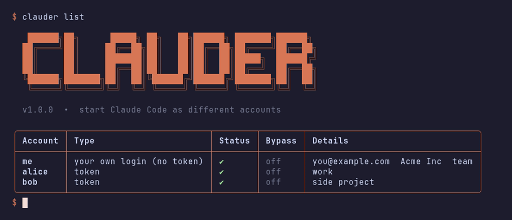
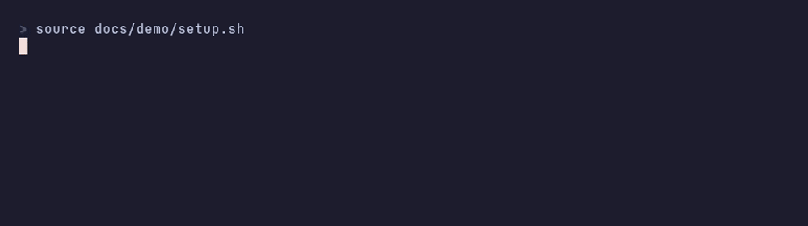

# clauder

Start Claude Code as a different account without logging out of your own.



`clauder` keeps a list of OAuth tokens made with `claude setup-token` and starts `claude` with
the one you pick. The token goes only to that `claude` process, through the
`CLAUDE_CODE_OAUTH_TOKEN` environment variable, so your normal login stays as it is.

It is one Node.js file with no dependencies, and it runs on Windows, macOS and Linux.

## Install

You need Node.js 18 or newer.

```sh
git clone https://github.com/fatih255/clauder
cd clauder
npm link        # puts the `clauder` command on your PATH (downloads nothing)
```

To uninstall, run `npm unlink -g clauder`.

## Pick an account

Run `clauder` with no arguments to get a menu. Move with the arrow keys and press Enter to pick
an account, then choose a new conversation or one to continue.


| Key | Action |
|---|---|
| ↑ ↓ or j k | move (wraps around) |
| 1 to 9 | jump to that row |
| Enter | pick the selected account |
| b | turn bypass permissions on or off for the selected account |
| a | add an account |
| Esc, q or Ctrl+C | quit |

If you already know the account, skip the menu. Anything after the name goes to `claude`
unchanged:

```sh
clauder alice           # start claude as alice
clauder alice -c        # continue alice's last conversation
clauder me              # your own login, no token
```

## Continue a conversation as another account

A conversation is not tied to an account. If one account hits its usage limit, you can carry on
the same conversation, with all of its history, as another account. From then on the usage
counts against that account.

After you pick an account in the menu, `clauder` lists your conversations from every project,
newest first, in the style of Claude Code's own resume screen. `clauder alice -r` opens the
same list.

Here alice left a conversation running in the background. Picking it as bob stops alice's
copy, opens the conversation with its history, and bob carries on:


| Key | Action |
|---|---|
| ↑ ↓, Page Up, Page Down | move |
| typing | filter by title, project folder or git branch |
| Enter | start `claude` as that account, in the conversation's own folder |
| Esc | clear the search, then go back to the accounts |

A conversation that is still running somewhere else keeps the account it was started with, and
`claude` refuses to open it a second time. `clauder` handles the two cases:

- **Running in the background** (`claude --bg`, or a session sent to the background): marked
  `bg`. Picking it runs `claude stop` on it first, then opens it as the account you chose, so
  the old copy cannot start again when its own limit resets.
- **Open in another terminal**: marked in red. `clauder` will not take it over; close it there
  first.

Passing a conversation yourself does the same check: `clauder alice --resume <id>` and
`clauder alice -c` ask before they stop a background copy.

### Background sessions use your own login

Claude Code runs background sessions (`claude --bg`) in a background service that uses the login
saved on your machine and ignores the token `clauder` passes. So `clauder alice --bg` would run,
and use the limits of, your own account rather than alice's. `clauder` refuses it when a login
is saved and tells you to start the session in the foreground instead. Conversations you continue
through `clauder` open in the foreground, so they do run as the account you picked.

## Add a token

The account owner runs `claude setup-token` on their own machine and sends you the
`sk-ant-oat01-...` value. Add it under a name you will remember:


The token is masked while you type. The note is optional and shows up in the menu and in
`clauder list`. Adding a name that already exists asks before replacing its token.

`clauder` never checks a token itself. If one has expired or been revoked, `claude` shows the
login error when it starts; get a fresh token and run `clauder add <name>` again.

## Bypass permissions

Each account has its own bypass switch, off by default. While it is on, `clauder` starts
`claude` with `--dangerously-skip-permissions`, so Claude runs tools and edits files without
asking first. The menu marks those accounts with a yellow `⚠ bypass` tag, and the launch line
repeats the warning.

Run `clauder bypass` to set them all at once. Space checks or unchecks the highlighted account,
Enter saves, and Esc leaves everything as it was.



For a single account, or in a script, name it:

```sh
clauder bypass alice on
clauder bypass alice off
clauder bypass alice       # flip it
clauder bypass me on       # works for your own login too
```

Pressing `b` in the main menu flips the highlighted account too. Arguments you pass yourself take priority: if you give
`--permission-mode` (for example `clauder alice --permission-mode plan`), `clauder` leaves the
flag off for that run. An organization policy can disable bypass mode, and then `claude`
refuses to start with it.

## All commands

```sh
clauder                    # menu
clauder <name> [args]      # start claude as <name>, passing [args] to claude
clauder <name> -r          # pick a conversation to continue as <name>
clauder me [args]          # start claude with your own login
clauder add [name]         # add or replace a token
clauder list               # accounts with their login status
clauder bypass             # checkbox list of all accounts
clauder bypass <name> [on|off]
clauder rename <old> <new>
clauder remove <name>
clauder path               # where accounts.json lives
```

`list`, `remove` and `rename` also answer to `ls`, `rm` and `mv`.

`clauder list` runs `claude auth status` once per account, so it takes about a second per row.
A token login shows only a green check. Your own login also shows its email, organization and
plan, because `setup-token` tokens are not allowed to read the account profile.

## Accounts file

Accounts live in `~/.clauder/accounts.json`. Set `CLAUDER_HOME` to keep them somewhere else.
The file is plain JSON, so you can edit it by hand:

```json
{
  "accounts": {
    "alice": { "token": "sk-ant-oat01-...", "addedAt": "2026-11-26T10:00:00.000Z", "note": "work", "bypass": true }
  },
  "me": { "bypass": true }
}
```

Tokens are stored in plain text. On macOS and Linux the file gets mode `600` and its folder
`700`. Don't share the file or copy it into this repo; `.gitignore` excludes `accounts.json` in
case it ends up here anyway.

Colors turn off when the output is not a terminal or when `NO_COLOR` is set. `FORCE_COLOR=1`
turns them back on.

## Re-recording the demos

The GIFs are made with [VHS](https://github.com/charmbracelet/vhs) inside Docker, and each one
ends with the real Claude Code starting up. The demo accounts hold fake `sk-ant-oat01-demo-*`
tokens; a small wrapper swaps them for a real token only when `claude` starts, so no real token
is typed or shown. The email and organization in `clauder list` are fake too, because the real
`claude auth status` prints them. To record them again after a UI change, run this from the
repo root with a token from `claude setup-token`:

```sh
CLAUDER_DEMO_TOKEN=sk-ant-oat01-... sh docs/demo/record.sh
```

If `~/.claude/.credentials.json` exists, it is copied into the container (read-only) so
`clauder me` opens with your own login.

The scripts are in `docs/demo/`.

## Before you use someone else's token

A token gives full use of its owner's Claude subscription, and everything you do with it counts
against their limits. Only use tokens you have permission to use.
