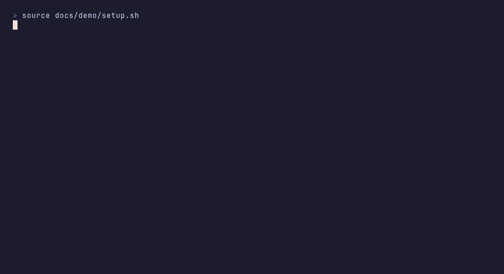

# clauder

Start Claude Code as a different account without logging out of your own.


`clauder` keeps a list of OAuth tokens made with `claude setup-token` and starts `claude` with
the one you pick. The token goes only to that `claude` process, through the
`CLAUDE_CODE_OAUTH_TOKEN` environment variable, so your normal login stays as it is.

It is one Node.js file with no dependencies, and it runs on Windows, macOS and Linux.

## Install

You need Node.js 18 or newer.

```sh
git clone https://github.com/fatih255/clauder
cd clauder
npm link        # puts the `clauder` command on your PATH (downloads nothing)
```

To uninstall, run `npm unlink -g clauder`.

## Pick an account

Run `clauder` with no arguments to get a menu. Move with the arrow keys and press Enter to start
`claude` with that account.


| Key | Action |
|---|---|
| ↑ ↓ or j k | move (wraps around) |
| 1 to 9 | jump to that row |
| Enter | start `claude` with the selected account |
| a | add an account |
| Esc, q or Ctrl+C | quit |

If you already know the account, skip the menu. Anything after the name goes to `claude`
unchanged:

```sh
clauder alice           # start claude as alice
clauder alice -c        # continue alice's last conversation
clauder me              # your own login, no token
```

## Add a token

The account owner runs `claude setup-token` on their own machine and sends you the
`sk-ant-oat01-...` value. Add it under a name you will remember:



The token is masked while you type. The note is optional and shows up in the menu and in
`clauder list`. Adding a name that already exists asks before replacing its token.

`clauder` never checks a token itself. If one has expired or been revoked, `claude` shows the
login error when it starts; get a fresh token and run `clauder add <name>` again.

## All commands

```sh
clauder                    # menu
clauder <name> [args]      # start claude as <name>, passing [args] to claude
clauder me [args]          # start claude with your own login
clauder add [name]         # add or replace a token
clauder list               # accounts with their login status
clauder rename <old> <new>
clauder remove <name>
clauder path               # where accounts.json lives
```

`list`, `remove` and `rename` also answer to `ls`, `rm` and `mv`.

`clauder list` runs `claude auth status` once per account, so it takes about a second per row.
A token login shows only a green check. Your own login also shows its email, organization and
plan, because `setup-token` tokens are not allowed to read the account profile.

## Accounts file

Accounts live in `~/.clauder/accounts.json`. Set `CLAUDER_HOME` to keep them somewhere else.
The file is plain JSON, so you can edit it by hand:

```json
{
  "accounts": {
    "alice": { "token": "sk-ant-oat01-...", "addedAt": "2026-11-26T10:00:00.000Z", "note": "work" }
  }
}
```

Tokens are stored in plain text. On macOS and Linux the file gets mode `600` and its folder
`700`. Don't share the file or copy it into this repo; `.gitignore` excludes `accounts.json` in
case it ends up here anyway.

Colors turn off when the output is not a terminal or when `NO_COLOR` is set. `FORCE_COLOR=1`
turns them back on.

## Re-recording the demos

The GIFs are made with [VHS](https://github.com/charmbracelet/vhs) inside Docker, using fake
accounts and a stand-in `claude`, so no real token or email shows up in them. To record them
again after a UI change, run this from the repo root:

```sh
sh docs/demo/record.sh
```

The scripts are in `docs/demo/`.

## Before you use someone else's token

A token gives full use of its owner's Claude subscription, and everything you do with it counts
against their limits. Only use tokens you have permission to use.
